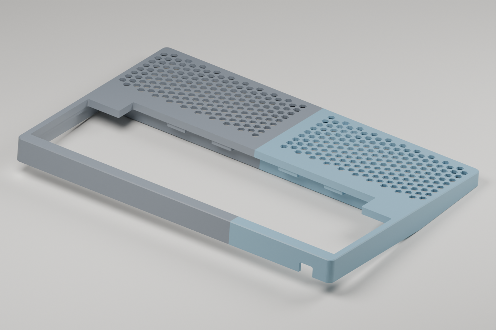
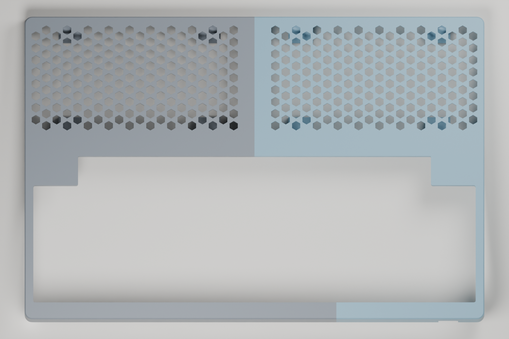
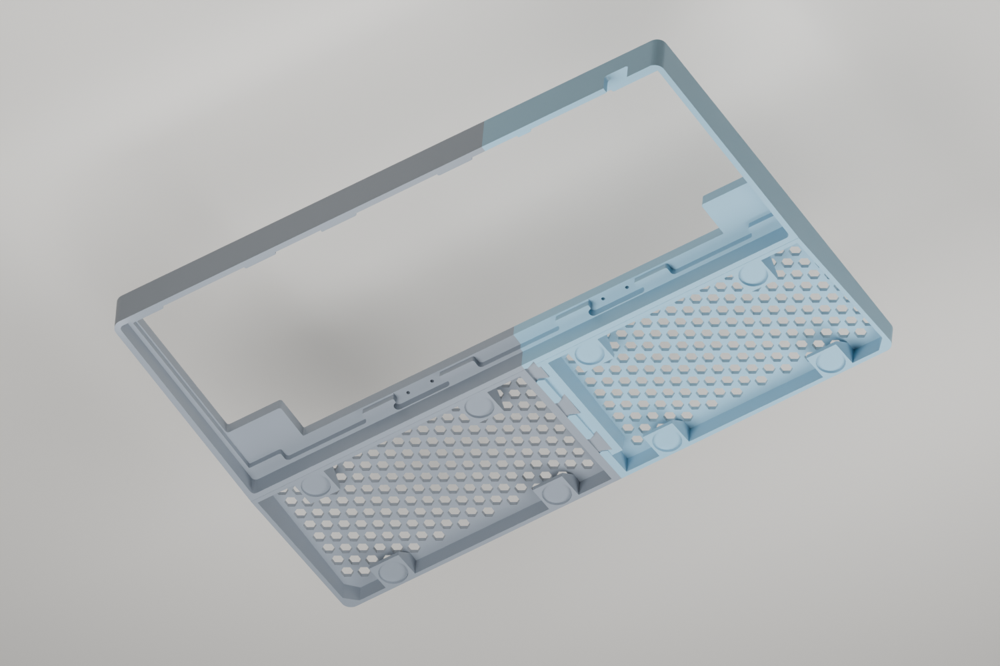

# Rule 60 V3 Honeycomb Wrist Rest — No Extra Hardware

A code-generated two-piece wrist rest by [minpeter](https://github.com/minpeter).
Integral sliding dovetails connect the halves without screws, magnets or
separate connectors. Optional adhesive anti-slip pads are not included.

[View on MakerWorld](https://makerworld.com/en/models/3490864-rule-60-v3-honeycomb-wrist-rest#profileId-3986872)

Also in this repository: an experimental [HHKB top case with the wrist rest
built in](#hhkb-top-case-with-integrated-wrist-rest-experimental).


## Download and print

**Current version: tight fit.** The owner printed the male joint coupon and
confirmed a very tight, fully seated fit with the existing receiver. The full
replacement body is being printed; full-body strength and long-term retention
have not been validated.

| File | Use |
| --- | --- |
| [Full wrist rest — 3MF](models/rule60-v9-honeycomb-body.3mf) | Both current halves on one plate |
| [Left / male — STL](models/left.stl) | Replacement male half |
| [Right / female — STL](models/right.stl) | Receiver half |
| [Both halves — STL](models/rule60-one-plate.stl) | Combined print plate |
| [Male-only replacement — 3MF](models/rule60-tight-fit-left.3mf) | Reuse an existing v9 receiver |
| [Male-only fit coupon — 3MF](models/rule60-tight-fit-test-left.3mf) | Test against your existing receiver first |
| [Two-joint fit test — 3MF](models/rule60-v9-joint-test.3mf) | Print both sides of the joint test |
| [Surface and pad sample — 3MF](models/rule60-v9-surface-pad-test.3mf) | Surface feel, adhesion and pad placement |

Existing `rule60-v9-*` download paths are retained, but the body and joint-test
files now contain the tight-fit revision. Older geometry remains in Git history.
The surface sample is unchanged.

Repository 3MFs contain **geometry only**, not printer settings or G-code.
Keep the supplied orientation: the sloping wrist-contact surface faces the
build plate. Re-slice for your printer, nozzle, filament and plate. MakerWorld
also provides a Bambu Studio print profile with the updated geometry.

Body: **295 × 80 × 21 mm**. Eight optional **10 × 4 × 1 mm** adhesive pads
give approximately **22 mm** installed height. The body has 2.4 mm honeycomb
ribs, a 2.2 mm skin and 0.2 mm aperture-edge relief, without X ribs or weight
inserts. Dimensions follow the owner's measured Rule 60 V3 front edge;
compatibility with other keyboard cases is not guaranteed.

## Fit and assembly

The male mating faces are expanded **0.20 mm** to close the original nominal
gap, with four rounded compression ribs adding **0.10 mm per flank** locally.
The v9 receiver interface is unchanged. This is **friction retention, not a
latch**: printing variation, wear and PETG creep can change the holding force.

Place the left half on a flat surface. Align the right half above both tongues,
then lower it evenly into place. Do not force the halves together horizontally
or hammer them. Test the coupon in the same material and settings first; a
successful fit should seat fully without cracking or damaging either half.

Already have a v9 receiver? Print only the male coupon, then the replacement
left half. **Do not combine the enlarged male with the smaller sockets from
the experimental `--clearance 0` revision.** Support both halves when carrying.

Attach equally thick pads inside all eight marked outlines, without covering
the bottom-open sockets. The outlines are not recessed pad pockets.


## Slicing

The updated MakerWorld profile preserves the owner's **X2D / 0.4 mm nozzle,
Bambu PETG Translucent, 0.20 mm layers, 3 walls, 15% infill and no supports**.
Its estimate is approximately **4.1 hours / 72 g**, not a measured completed
print time. Select your own printer, filament and build plate before slicing.

Inspect first-layer adhesion, dovetail overhangs, compression ribs and pad
ledges in the layer preview. The CLI slice completed but reported ZFiller and
reserved-tool-command diagnostics; their impact remains unresolved. A
successful CLI exit does not prove every toolpath is correct. Do not enable
supports inside the mating sockets without checking removal access.

## Reproduce and continue designing

Install [uv](https://docs.astral.sh/uv/), clone the repository, then run:

```sh
uv sync --locked
# Original receiver and no-rib comparison baselines for verification:
uv run build.py 2.4
uv run build.py 2.4 --male-expansion 0.20
# Current published fit:
uv run build.py 2.4 --male-expansion 0.20 --compression 0.10
uv run verify.py rib-2.4-male-expanded-0.20-compression-0.10
uv run export.py
```

`build.py` constructs the geometry in code and reads no external STL or 3MF.
Outputs are in the ignored `rib-2.4-male-expanded-0.20-compression-0.10/`
directory. `rule60-one-plate.3mf`, `replacement-left.3mf`,
`replacement-test-left.3mf` and `test-joint-plate.3mf` correspond to the
downloads above. STL exports use millimetres.

`export.py` refreshes `models/` and the verification evidence. Published STLs
are binary: export removes triangles that collapse at float32 precision, then
checks closed meshes, component counts, dimensions and volume after reload.
This avoids degenerate faces when MakerWorld converts ASCII STL downloads.

The default command without fit options intentionally reproduces the original
looser v9. `--male-expansion 0.20` without `--compression` provides a no-rib
control. Other supported compression values are `0` and `0.05`; fit changes
require a new coupon test. Do not globally scale a part to adjust the joint.

For optional CAD renders, install Blender separately:

```sh
blender -b --python render.py -- rib-2.4-male-expanded-0.20-compression-0.10
```

`uv.lock` pins geometry/check dependencies. Blender and Bambu Studio are
external applications. Private printer configuration, raw logs and caches
are not included; save your own slicer project for repeatable printing.

## Verification and limitations

[Current verification](evidence/verification.json) checks closed connected
meshes, dimensions, plate bounds, 89 insertion positions, intentional contact
confined to the compression ribs, an unchanged receiver, root and entry
geometry, aperture relief, pad heights and layer-section connectivity.
[Current dimensions](evidence/dimensions.json) record the fit parameters.

These checks do not simulate deformation, insertion force, wear, creep or
full-body stiffness. The owner's coupon test confirms fit for their print,
not a universal tolerance guarantee. CAD images are illustrations, not proof
of physical strength or transparent PETG appearance. The overview images
predate the small compression ribs. Automated visual review of the latest
renders was unavailable due to an image-upload quota.

[Historical rib comparison](evidence/rib-comparison.json) covers the original
v9 candidates, not the current tight-fit slicing estimate.

## HHKB top case with integrated wrist rest (experimental)

A replacement Rule 60 V3 **HHKB** top case with the honeycomb wrist rest built
in. It reuses the stock bottom case, PC gasket plate, 12 silicone gasket caps
and four ball-catch strike plates. The case outline and Z levels follow the
owner's caliper measurements of the stock top case; the gasket-cap and
ball-catch pockets follow photo metrology of the same part.

**License: [CC BY-NC 4.0](LICENSE-topcase)**, personal and other non-commercial
use only (the wrist rest above stays CC BY 4.0; see
[License](#license-and-design-history)).

| Assembled | Top |
| --- | --- |
|  |  |
| **Exploded** | **Underside** |
|  |  |

Renders are CAD illustrations (left half grey, right half blue), not print
photos.

**Status: test-fitted in print.** The owner's v7.4 print (both halves)
assembles on the stock bottom case, plate and gaskets, and the joints fit well.
On the desk the wrist rest sits slightly high and creaks when pressed, most
likely because the stock bottom-case feet hold the keyboard about 2 mm above
the desk (estimated, not measured) while the model puts the wrist-rest
underside level with the top-case lip. Bumpons under the wrist rest fill that
gap. The USB-C connector works but sits about 2 mm off-centre in its notch.
v7.6 and v7.7 address these and have not been printed yet. Fixes found by
printing:

- **v7.0:** v6.2 and earlier printed the mirror image: the DWG plate frame is a
  top view, the print frame the underside. The USB-C notch came out on the
  wrong side and the two outer back gasket pockets sat ~10 mm off their tabs.
  The verification now checks the USB-C side and the inward back-left pocket.
- **v7.1–v7.3:** bottom-case pocket corners R5.0 → R2.0 (the R5.0 held the
  stock bottom case ~2.3 mm off at the corners); outer corners R8.0 → R4.85,
  concentric with them; USB-C notch 12.8 mm wide with R1.5 corners, from the
  stock notch photographed against the print.
- **v7.4:** USB-C notch 8.7 mm deep from the lip.
- **v7.5 (not printed):** the eight bumpon pads run 11 mm instead of 6 mm in,
  so a 3M Bumpon SJ5302 (Ø7.9 mm) sits wholly on its pad instead of hanging
  ~1 mm past the front face.
- **v7.6:** the pads take the flat-top 3M Bumpon SJ5012 (Ø12.7 × 3.5 mm)
  instead: 16 × 16 mm pads, each with a Ø13.6 × 1.5 mm pocket square to the
  desk, so the bumpon stands 2.0 mm proud and the pocket wall resists sideways
  push. Past ~6 mm each pad is a 45° corbel (no supports).
- **v7.7:** USB-C notch centre 2 mm further from the keyboard centre (toward
  the Esc-side edge); width and depth unchanged.

[Fit photos](evidence/topcase/README.md#photos) are in the evidence folder.

| File | Use |
| --- | --- |
| [Left half — 3MF](models/rule60-hhkb-topcase-left.3mf) | 206 × 197 mm print, ~78 g |
| [Right half — 3MF](models/rule60-hhkb-topcase-right.3mf) | 149 × 197 mm print, ~67 g |
| [Fit coupons — 3MF](models/rule60-hhkb-topcase-fit-coupons.3mf) | Front-left corner, front joints and back seam |
| [CAD — STEP](models/rule60-hhkb-topcase.step) | Both halves, for remixing |

Assembled: **298.1 × 198.3 mm**, 20.01 mm case height. The halves split at the
centre through the wrist rest and front bezel, joined by three sliding
dovetails with compression ribs. The back bezel continues on the left half to
the back-left ball-catch strike (the one nearest the USB-C side of centre),
whose stock plate bridges the back seam with one M2 screw in each half; a wedge
key aligns that seam. Every joint side face
is line-to-line (0 mm); the dovetail landings and the faces under each 45°
print ramp keep a 0.20 mm vertical glue line. Use epoxy or gel cyanoacrylate.
Strike-plate screws must not exceed **5.0 mm under the head** (1.45 mm plate +
3.55 mm pilot).

**Bumpons:** eight **3M™ Bumpon™ Protective Products SJ5012**: cylindrical,
flat top, Ø12.7 × 3.5 mm (±0.5 mm), black, white, grey or brown. The same
shape is sold as **SJ5312** (transparent) and **SJ5412** (true white); any of
the three fits ([3M datasheet](https://multimedia.3m.com/mws/media/117314O/3m-bumpon-protective-products-molded-shapes-colored-and-clear.pdf)).
Press one into each pocket under the wrist rest, four along the front edge and
four along the keyboard junction. Each stands 2.0 mm proud of the pad, to fill
the ~2 mm the stock feet lift the keyboard (estimated, not measured). The
hemispherical **SJ5302** (Ø7.9 × 2.2 mm, transparent; SJ5302BL is its
80-piece blister pack) does not suit the pockets: it would stand only 0.7 mm
proud.

### Printing

Print each half on its own plate in the supplied orientation, top face on the
plate, without supports or brim. The owner's settings: X2D / 0.4 mm nozzle,
Bambu PETG Translucent, 0.20 mm Standard, 3 walls, 15% infill, textured PEI,
default 0.15 mm elephant-foot compensation. The textured plate forms the
visible top surface.

These 3MFs include a Bambu Studio / Orca **height-range modifier: 0.10 mm
layers from Z 5.4 to 10.0 mm**. At 0.20 mm the 6.30 mm gasket-cap floor
prints at 6.4 and the 9.69 mm bottom-case seat at 9.6, pinching the caps
0.19 mm more; with the range they print at 6.3 and 9.7. Confirm the range in
the object list after opening. Bambu Studio CLI estimates (v7.6; v7.7 only
moves the USB-C notch, same volume): left 4 h 25 min / 78 g, right
3 h 57 min / 67 g; coupons (unchanged since v7.4) 1 h 47 min / 33 g. The CLI
slice reported ZFiller diagnostics.

### Reproduce

The build drives the SolidCraft v0.22.0 headless CLI
(`~/.local/bin/solidcraft-cli`), which is not included. The checks need the
`6095(gas)` plate outline from `rule60-v3.dwg` in
[minjunkim0205/Hobby-CustomKeyboard](https://github.com/minjunkim0205/Hobby-CustomKeyboard/tree/ecf3575e9fb844d32f57b42ce6f7f23f30294396/keyboards/housings/Rule60),
converted to JSON with [`@mlightcad/libredwg-web`](https://www.npmjs.com/package/@mlightcad/libredwg-web);
the drawing is not redistributed here.

```sh
uv run build_topcase_draft.py
RULE60_DWG_JSON=/path/to/rule60-v3.json uv run verify_topcase.py
blender -b -P render_topcase_draft.py   # optional renders
uv run export_topcase.py
```

Outputs go to the ignored `topcase-draft/`; `export_topcase.py` copies the
downloads, STEP, [report](evidence/topcase-report.json),
[verification](evidence/topcase-verification.json) and renders.

### Measurements and evidence

[evidence/topcase/](evidence/topcase/README.md) lists every caliper value with
its photo or source and the design constant it sets, the photo-derived values
and their method, the measurement photos (metadata removed), the analysis
images and the check outputs, including the as-printed re-check.

### Verification and limitations

The verification checks closed single-shell exports, a 91-step insertion
path with contact only on the compression ribs, 0 mm side faces and 0.20 mm
glue lines, the back-seam strike screws, layer islands and flat overhangs, and
virtual stock parts: the DWG plate through 0.25 mm upward flex, 12 caps,
four strikes, 60 HHKB keycaps through full travel and the stock bottom-case
pocket, the USB-C notch side, width and depth, and an Ø13.2 mm bumpon
(3M Bumpon SJ5012 at its +0.5 mm tolerance) fitting each of the eight wrist-rest pockets
on a full floor with at least 1 mm of wall. The v7.4 halves, rebuilt at the printed
layer heights, passed the same checks except one: the wedge-key tip's top
0.10 mm layer reaches 0.05 mm into the notch layer below it, so the key tip
bears after ~0.15 mm of the 0.20 mm vertical glue line instead of 0.20 mm
([as-printed check](evidence/topcase/checks/as-printed-check.json)).

Not covered: the stock bottom case was not measured (its pocket copies the
stock top case, its corner radius comes from the v6.2 fit); the front
ball-catch strikes are centred in the available band, not measured; cap size
is photo-derived and the front caps clear their pocket wall by only 0.07 mm;
the stock plate is assumed to match the DWG; the outer corner radius is not
measured. Clearance to the plate (0.30 mm per side) and keycaps (0.32 mm)
tolerates up to about 0.2% print shrinkage.

## License and design history

Copyright 2026 minpeter. Two licenses apply:

- **Wrist rest — [CC BY 4.0](LICENSE).** Everything not listed under the top
  case below: the wrist-rest generator, its model exports, documentation and
  renders. Attribute this project, link to the license and identify your
  changes. Commercial use is permitted.
- **HHKB top case — [CC BY-NC 4.0](LICENSE-topcase), personal and other
  non-commercial use only.** `build_topcase_draft.py`, `export_topcase.py`,
  `render_topcase_draft.py`, `verify_topcase.py`, `models/rule60-hhkb-topcase*`,
  `images/topcase-*` and `evidence/topcase*`. You may print, modify and share
  it for non-commercial purposes with attribution. Selling the files, prints
  or derived designs requires the owner's permission.

The top-case license applies to every version of the top case in this
repository, including all earlier commits and branches, which previously
stated CC BY 4.0.

Third-party tools retain their own licenses. No affiliation with keyboard or
printer manufacturers is implied. The Rule 60 V3 is designed by INKC STUDIO;
the top case is an independent re-creation from measurements of the owner's
stock part and is not an official file.

Early experiments took inspiration from [Shanhj's palm rest](https://makerworld.com/en/models/1326999).
The final v9 generator constructs its geometry in code and embeds neither
that model's mesh nor the Bunny/Dunny connector used in earlier experiments.
This history is acknowledged without claiming the original creator authored
or licensed the v9 generator. The owner's CC BY release does not grant rights
in anyone else's work or constitute a legal determination of independence.
