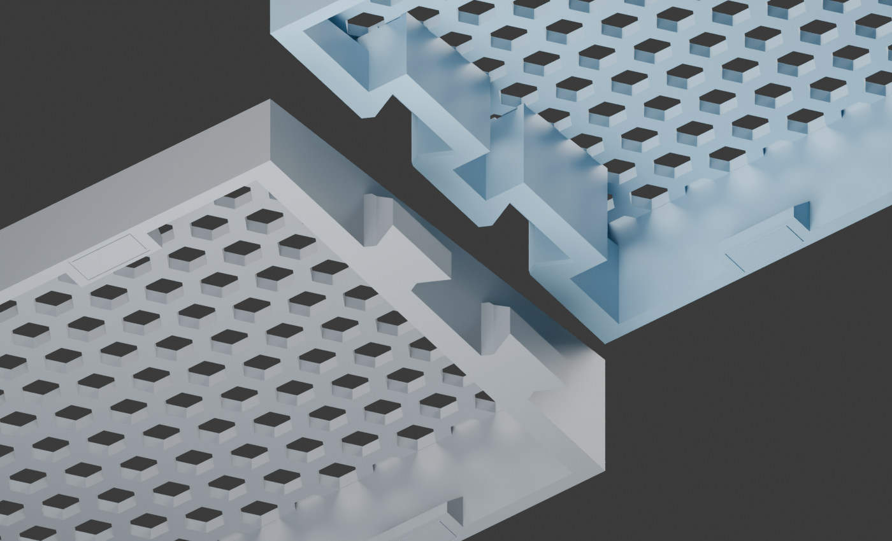
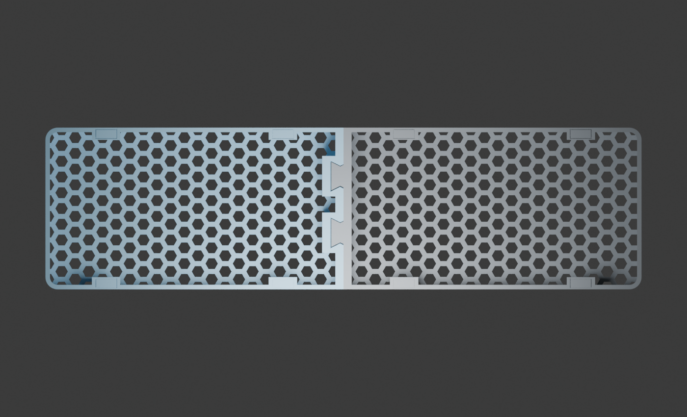

# Rule 60 V3 Honeycomb Wrist Rest — No Extra Hardware

A code-generated two-piece wrist rest by [minpeter](https://github.com/minpeter).
Integral sliding dovetails connect the halves without screws, magnets or
separate connectors. Optional adhesive anti-slip pads are not included.

[View on MakerWorld](https://makerworld.com/en/models/3490864-rule-60-v3-honeycomb-wrist-rest#profileId-3986872)



## Download and print

**Current version: tight fit.** The owner printed the male joint coupon and
confirmed a very tight, fully seated fit with the existing receiver. The full
replacement body is being printed; full-body strength and long-term retention
have not been validated.

| File | Use |
| --- | --- |
| [Full wrist rest — 3MF](models/rule60-v9-honeycomb-body.3mf) | Both current halves on one plate |
| [Left / male — STL](models/left.stl) | Replacement male half |
| [Right / female — STL](models/right.stl) | Receiver half |
| [Both halves — STL](models/rule60-one-plate.stl) | Combined print plate |
| [Male-only replacement — 3MF](models/rule60-tight-fit-left.3mf) | Reuse an existing v9 receiver |
| [Male-only fit coupon — 3MF](models/rule60-tight-fit-test-left.3mf) | Test against your existing receiver first |
| [Two-joint fit test — 3MF](models/rule60-v9-joint-test.3mf) | Print both sides of the joint test |
| [Surface and pad sample — 3MF](models/rule60-v9-surface-pad-test.3mf) | Surface feel, adhesion and pad placement |

Existing `rule60-v9-*` download paths are retained, but the body and joint-test
files now contain the tight-fit revision. Older geometry remains in Git history.
The surface sample is unchanged.

Repository 3MFs contain **geometry only**, not printer settings or G-code.
Keep the supplied orientation: the sloping wrist-contact surface faces the
build plate. Re-slice for your printer, nozzle, filament and plate. MakerWorld
also provides a Bambu Studio print profile with the updated geometry.

Body: **295 × 80 × 21 mm**. Eight optional **10 × 4 × 1 mm** adhesive pads
give approximately **22 mm** installed height. The body has 2.4 mm honeycomb
ribs, a 2.2 mm skin and 0.2 mm aperture-edge relief, without X ribs or weight
inserts. Dimensions follow the owner's measured Rule 60 V3 front edge;
compatibility with other keyboard cases is not guaranteed.

## Fit and assembly

The male mating faces are expanded **0.20 mm** to close the original nominal
gap, with four rounded compression ribs adding **0.10 mm per flank** locally.
The v9 receiver interface is unchanged. This is **friction retention, not a
latch**: printing variation, wear and PETG creep can change the holding force.

Place the left half on a flat surface. Align the right half above both tongues,
then lower it evenly into place. Do not force the halves together horizontally
or hammer them. Test the coupon in the same material and settings first; a
successful fit should seat fully without cracking or damaging either half.

Already have a v9 receiver? Print only the male coupon, then the replacement
left half. **Do not combine the enlarged male with the smaller sockets from
the experimental `--clearance 0` revision.** Support both halves when carrying.

Attach equally thick pads inside all eight marked outlines, without covering
the bottom-open sockets. The outlines are not recessed pad pockets.



## Slicing

The updated MakerWorld profile preserves the owner's **X2D / 0.4 mm nozzle,
Bambu PETG Translucent, 0.20 mm layers, 3 walls, 15% infill and no supports**.
Its estimate is approximately **4.1 hours / 72 g**, not a measured completed
print time. Select your own printer, filament and build plate before slicing.

Inspect first-layer adhesion, dovetail overhangs, compression ribs and pad
ledges in the layer preview. The CLI slice completed but reported ZFiller and
reserved-tool-command diagnostics; their impact remains unresolved. A
successful CLI exit does not prove every toolpath is correct. Do not enable
supports inside the mating sockets without checking removal access.

## Reproduce and continue designing

Install [uv](https://docs.astral.sh/uv/), clone the repository, then run:

```sh
uv sync --locked
# Original receiver and no-rib comparison baselines for verification:
uv run build.py 2.4
uv run build.py 2.4 --male-expansion 0.20
# Current published fit:
uv run build.py 2.4 --male-expansion 0.20 --compression 0.10
uv run verify.py rib-2.4-male-expanded-0.20-compression-0.10
uv run export.py
```

`build.py` constructs the geometry in code and reads no external STL or 3MF.
Outputs are in the ignored `rib-2.4-male-expanded-0.20-compression-0.10/`
directory. `rule60-one-plate.3mf`, `replacement-left.3mf`,
`replacement-test-left.3mf` and `test-joint-plate.3mf` correspond to the
downloads above. STL exports use millimetres.

`export.py` refreshes `models/` and the verification evidence. Published STLs
are binary: export removes triangles that collapse at float32 precision, then
checks closed meshes, component counts, dimensions and volume after reload.
This avoids degenerate faces when MakerWorld converts ASCII STL downloads.

The default command without fit options intentionally reproduces the original
looser v9. `--male-expansion 0.20` without `--compression` provides a no-rib
control. Other supported compression values are `0` and `0.05`; fit changes
require a new coupon test. Do not globally scale a part to adjust the joint.

For optional CAD renders, install Blender separately:

```sh
blender -b --python render.py -- rib-2.4-male-expanded-0.20-compression-0.10
```

`uv.lock` pins geometry/check dependencies. Blender and Bambu Studio are
external applications. Private printer configuration, raw logs and caches
are not included; save your own slicer project for repeatable printing.

## Verification and limitations

[Current verification](evidence/verification.json) checks closed connected
meshes, dimensions, plate bounds, 89 insertion positions, intentional contact
confined to the compression ribs, an unchanged receiver, root and entry
geometry, aperture relief, pad heights and layer-section connectivity.
[Current dimensions](evidence/dimensions.json) record the fit parameters.

These checks do not simulate deformation, insertion force, wear, creep or
full-body stiffness. The owner's coupon test confirms fit for their print,
not a universal tolerance guarantee. CAD images are illustrations, not proof
of physical strength or transparent PETG appearance. The overview images
predate the small compression ribs. Automated visual review of the latest
renders was unavailable due to an image-upload quota.

[Historical rib comparison](evidence/rib-comparison.json) covers the original
v9 candidates, not the current tight-fit slicing estimate.

## License and design history

Copyright 2026 minpeter. The authored source, model exports, documentation and
renders are released under **[CC BY 4.0](LICENSE)**. Attribute this project,
link to the license and identify your changes. Commercial use is permitted.
Third-party tools retain their own licenses. No affiliation with keyboard or
printer manufacturers is implied.

Early experiments took inspiration from [Shanhj's palm rest](https://makerworld.com/en/models/1326999).
The final v9 generator constructs its geometry in code and embeds neither
that model's mesh nor the Bunny/Dunny connector used in earlier experiments.
This history is acknowledged without claiming the original creator authored
or licensed the v9 generator. The owner's CC BY release does not grant rights
in anyone else's work or constitute a legal determination of independence.
